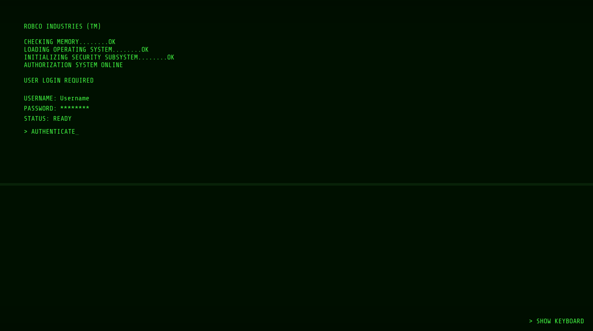

# Fallout SDDM

A Fallout-inspired SDDM login theme built for Qt 6 and SDDM 0.21+.



## Features

- Qt 6 native (`sddm-greeter-qt6`)
- Terminal-style boot sequence
- Randomized typing sounds
- Power-on and authentication sounds
- On-screen keyboard toggle
- Adjustable volume

## Requirements

Install these first. On Arch Linux:

```bash
sudo pacman -S sddm qt6-multimedia qt6-virtualkeyboard ttf-sharetech-mono-nerd
```

| Package | Why |
| --- | --- |
| `sddm` (0.21+) | Display manager (Qt 6 build) |
| `qt6-multimedia` | Sound effects. You also need a multimedia backend, such as `qt6-multimedia-ffmpeg` |
| `qt6-virtualkeyboard` | Required. The theme imports it |
| `ttf-sharetech-mono-nerd` | The font (`ShureTechMono Nerd Font`). Must be installed system-wide |

On other distros, install the equivalent Qt 6 packages and the Share Tech Mono Nerd Font.

## Installation

### 1. Clone and install

```bash
git clone https://github.com/Vaderfan10/fallout-sddm.git
sudo mkdir -p /usr/share/sddm/themes
sudo cp -r fallout-sddm /usr/share/sddm/themes/fallout-sddm
```

Run the `cp` from the folder that contains the clone (not from inside it).

### 2. Set as the active theme

```bash
sudo mkdir -p /etc/sddm.conf.d
printf "[Theme]\nCurrent=fallout-sddm\n" | sudo tee /etc/sddm.conf.d/10-theme.conf
```

This uses a drop-in file, so it won't overwrite any existing SDDM settings.

### 3. Test before logging out (recommended)

```bash
sddm-greeter-qt6 --test-mode --theme /usr/share/sddm/themes/fallout-sddm
```

### 4. Restart SDDM

```bash
sudo systemctl restart sddm
```

Note: this ends your current session. Save your work first, or just reboot.

## Settings

Near the top of `Main.qml`:

```qml
property real keyVolume: 0.5       // typing sounds
property real systemVolume: 1.0    // power-on / power-off sounds
```

## Virtual keyboard

The theme includes a "SHOW KEYBOARD" toggle in the lower-right corner. To make SDDM use Qt's virtual keyboard, add:

```bash
printf "[General]\nInputMethod=qtvirtualkeyboard\n" | sudo tee /etc/sddm.conf.d/20-virtualkbd.conf
```

## Troubleshooting

- **Black screen or falls back to another theme:** run the test command in step 3 and read the error output. Missing `qt6-virtualkeyboard` or `qt6-multimedia` is the most common cause.
- **Wrong font:** check `fc-list | grep -i shure` prints `ShureTechMono Nerd Font`, then run `fc-cache -f` and restart SDDM.
- **No sound:** install a multimedia backend (see Requirements).

## Directory layout

```
fallout-sddm/
├── Main.qml
├── metadata.desktop
├── Sounds/
├── Themes/
│   └── fallout.conf
└── Screenshots/
```

## Credits and licensing

The theme code is MIT licensed (see `LICENSE`).

The terminal sound effects and startup/shutdown audio come from the
[Hyper ROBCO](https://github.com/smiley/hyper-robco) project by smiley:

- ui_hacking_charsingle_01–06.wav
- ui_hacking_charenter_01–03.wav
- poweron.wav / poweroff.wav (adapted from Hyper ROBCO assets)

These audio files are **not** covered by this repository's MIT license.
They may originate from third-party game assets. Fallout and ROBCO are
trademarks of their respective owners. This is an unofficial fan project and is not
affiliated with or endorsed by Bethesda.
